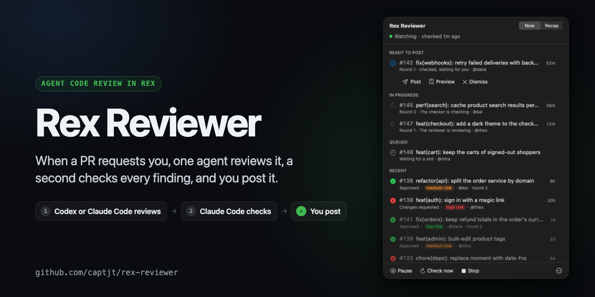
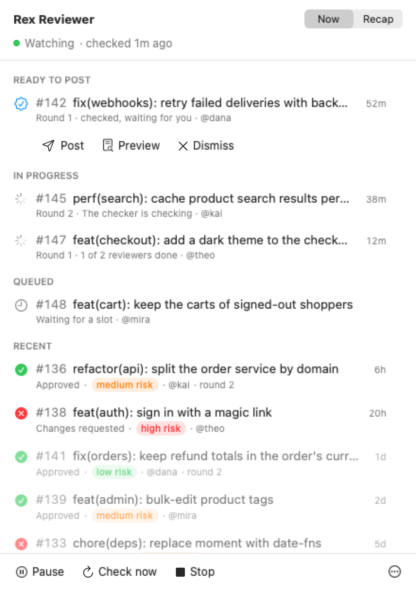
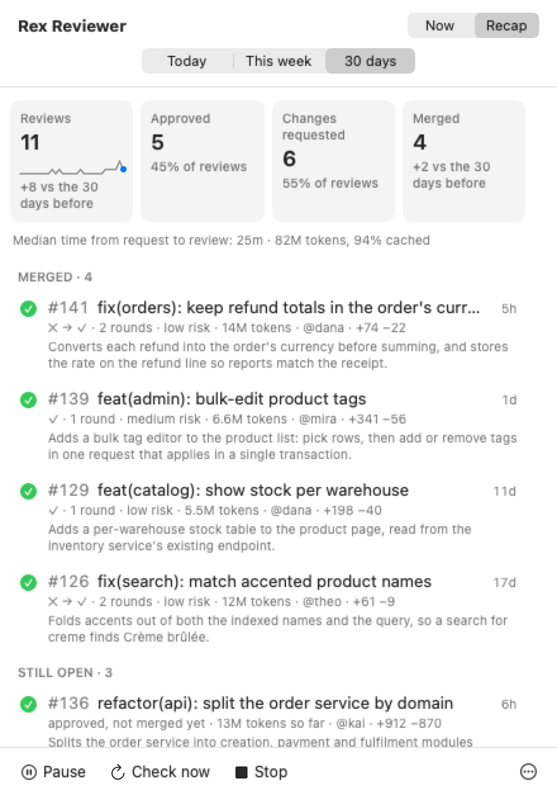

# rex-reviewer



Agent code review for the GitHub PRs that request you, run in
[Rex](https://www.superlogical.com/rex). When someone asks you to review a
PR, one or more reviewer agents (Codex, Claude Code, or both side by side)
review it in its own Rex tab, and a checker (Claude Code) checks every
finding against the code. You then post the checked review, or let it post
on its own. Every review says which agents wrote it, on your behalf:

```markdown
---

<div align="right"><sub><i>Codex (GPT-6.1-Sol) on behalf of @you · checked by Claude Code (Opus 5.5)</i></sub></div>
```

It runs on your machine, in your Rex session, with your own agents and
skills. A watcher written in Rex Lua does the bookkeeping and spends no
tokens. A menu bar app shows what's happening.

> Rex is in private beta. rex-reviewer needs a Rex build with Lua actions,
> `rex do` scripts, and the program status that Claude Code and Codex report.

## How a round works

1. **The request.** The watcher checks GitHub every few minutes for open PRs
   in your repos that request you by name.
2. **Prep.** It checks the PR out into its own worktree, and fetches the
   description, diff, reviews, comments, and CI results into
   `.tmp/context/`, so the agents never call GitHub.
3. **The reviewers** review the change in a new Rex tab, run the tests and
   probes they need, and each draft a review. With more than one, each works
   in its own worktree and pane, blind to the others. Later rounds resume the
   same agent sessions, so each remembers its last round.
4. **The checker**, a fresh Claude Code beside them, starts once every
   reviewer is done. It merges the drafts, verifies every finding, drops
   what it can't confirm, and assesses the merge risk.
5. **The post.** With `post = "ask"` (the default), the checked review waits
   for you: post it, preview it, or dismiss it from the menu bar. With
   `post = "auto"`, the checker posts it.
6. **Later rounds.** A push with no re-request is only noted. A re-request
   starts the next round, which checks what changed. If the head moves
   mid-round, the reviewers review the new commits first. When the PR merges
   or closes, its tab, worktrees, and refs are cleaned up.

## Requirements

- macOS and Rex
- [`gh`](https://cli.github.com), signed in as the account that reviews,
  plus `git` and `jq`
- A reviewer: [Codex](https://github.com/openai/codex) (which also needs
  `sqlite3`, part of macOS) or [Claude Code](https://claude.com/claude-code)
- Claude Code for the checker
- Swift 6 (Xcode or its command line tools), for the menu bar app

## Install

```sh
git clone https://github.com/captjt/rex-reviewer ~/src/rex-reviewer
ln -s ~/src/rex-reviewer/bin/rex-reviewer ~/.local/bin/rex-reviewer   # any folder on your PATH
rex-reviewer setup
```

`setup` creates `~/.config/rex-reviewer/config.lua` from
[`examples/config.lua`](examples/config.lua) and prints the line that loads
rex-reviewer from Rex's `~/.config/rex/init.lua`:

```lua
dofile("/Users/you/src/rex-reviewer/init.lua")
```

Add your repos to the config, then:

```sh
rex config reload
rex-reviewer doctor          # checks the config, the tools, and each repo's checkout
rex-reviewer up              # starts the rex-reviewer session and its watcher
rex-reviewer launch-agent    # optional: start it at login, and repair it every 5 minutes
rex-reviewer app --login     # optional: build the menu bar app, and open it at login
```

## Configure

The config is a Lua file that returns a table, so hooks are plain functions.
[`examples/config.lua`](examples/config.lua) shows every option.

```lua
return {
  repos = {
    ["your-org/your-repo"] = {
      checkout = "~/src/your-repo",
      notes = "Run `make test`; the e2e suite needs Docker, so skip it.",
    },
  },
  reviewer = "codex",   -- or "claude", or several reviewers: see below
  post = "ask",         -- or "auto"
  max_rounds = 3,
}
```

### Reviewers: one or several

`reviewer = "codex"` runs one reviewer. `reviewers` runs up to four side by
side on every round, each in its own worktree and pane, without seeing the
others' drafts. The checker merges their drafts, and records which reviewer
found each finding (`found_by`), so you can see what each one adds:

```lua
reviewers = {
  { name = "codex", agent = "codex" },          -- the first is the primary
  { name = "claude", agent = "claude",
    extra_args = { "--model", "claude-opus-5-5" },
    guides = { review = "~/.config/rex-reviewer/guides/deep-review.md" } },
},
```

- `name` labels the reviewer's pane and worktree: lowercase letters, digits,
  and dashes, up to 12. `agent` is `codex` or `claude`.
- `extra_args` adds to `agents.<agent>` for this reviewer only, and
  `guides.review` replaces the review guide for it.
- The primary keeps the PR's worktree (`pr-<n>`) and pane (`<repo>-<pr>`),
  where the checker works. The others get `pr-<n>-<name>` and
  `<repo>-<pr>-<name>`, split into the same tab. Each extra reviewer builds
  in its own worktree, so it costs a build and its disk.
- Every reviewer must finish before the checker starts. One that's blocked,
  or whose pane closes, holds the round and asks for you.
- Each round's history records, for each reviewer, the findings it drafted,
  how many the checker kept, how many only it found, its tokens, and its
  effort.

### Guides: bring your own skills

rex-reviewer doesn't make you use its skills. Four guide slots point the
agents at yours:

| Slot | What it shapes | Default |
| --- | --- | --- |
| `review` | how the reviewer looks for problems | a built-in method: read the diff, trace the code, run the tests |
| `style` | how the posted review reads | [`guides/review-style.md`](guides/review-style.md) |
| `merge_risk` | the merge-risk rubric | [`guides/merge-risk.md`](guides/merge-risk.md) |
| `check` | extra instructions for the checker | none |

Each slot takes a path to a file (such as a skill's `SKILL.md`), a string of
instructions, a `function(pr)` that returns either, `"bundled"` for the
default, or `false` for none. Set them for every repo, or per repo:

```lua
guides = {
  review = "Run the $review-swarm skill on the diff, then check its findings yourself.",
  style = "~/.agents/skills/my-review-voice/SKILL.md",
  merge_risk = false,  -- no merge-risk assessment
},
repos = {
  ["your-org/payments"] = {
    checkout = "~/src/payments",
    guides = { check = "Rerun every probe that touches money twice." },
  },
},
```

Only the draft format is fixed, because the posting script reads it:
[`docs/review-draft.md`](docs/review-draft.md).

### Effort: deeper on the PRs that need it

`effort` sets how hard the agents think, round by round: `review` for the
reviewers and `check` for the checker. Each takes a level (`low`, `medium`,
`high`, `xhigh`, or `max`), a `function(pr)` that returns one, or `false`
for the agent's own setting. Claude Code gets `--effort <level>`, and Codex
gets `-c model_reasoning_effort=<level>`, in place of any effort in `args` or
`extra_args`. A function that returns `nil` leaves those as they are.

```lua
effort = {
  review = function(pr)
    if pr.round > 1 then
      if pr.last_merge_risk == "high" then return "xhigh" end
      if pr.delta_lines and pr.delta_lines < 100 then return "medium" end
    end
    if pr.touches({ "migrations/", "auth/", ".github/workflows/" }) then return "xhigh" end
    if pr.lines < 150 then return "medium" end
    if pr.lines > 1500 then return "xhigh" end
    return "high"
  end,
  check = "high",
},
```

A function sees the PR as the round starts:

| Field | What it is |
| --- | --- |
| `repo`, `pr`, `title`, `author`, `round` | the PR, and the round about to start |
| `additions`, `deletions`, `lines`, `changed_files` | its size; `lines` is the first two summed |
| `files`, `labels` | its file paths and label names |
| `touches(...)` | true when a path contains any string given, as a list or as arguments |
| `delta_lines` | from round 2: the lines changed since the last round, or `nil` |
| `last_verdict`, `last_blocking`, `last_merge_risk` | how the agents' last posted round ended, or `nil` in round 1 |
| `drafted`, `drafted_blocking` | the checker's only: the findings the reviewers drafted, and how many are blocking |

Merge risk is the checker's assessment, so it can't set round 1's effort.
Paths and size can, and the last round's risk can set the rounds after it.

A repo's `effort` overrides these slot by slot, and a reviewer's own `effort`
overrides `review` for it:

```lua
reviewers = {
  { name = "codex", agent = "codex", effort = "medium" },
  { name = "claude", agent = "claude" },  -- effort.review
},
```

Each round's history records the level each reviewer and the checker ran at,
read from its session, so you can compare what each level costs and finds.
`rex-reviewer doctor` runs each function on an empty PR and shows the effort
in use.

### Briefs

The prompts each agent gets live in [`briefs/`](briefs). To change one, copy
it to `~/.config/rex-reviewer/briefs/` with the same name and edit it; yours
wins. They use placeholders such as `{{PR}}`, `{{HEAD}}`, and `{{BASE}}`,
which `lua/rex_reviewer/rounds.lua` fills in.

### Agents

`agents.codex` and `agents.claude` take `args`, which replaces the adapter's
own arguments, and `extra_args`, which adds to them. Use `extra_args` to turn
off MCP servers or plugins a reviewer shouldn't have. To add another agent,
add an adapter to [`lua/rex_reviewer/agents.lua`](lua/rex_reviewer/agents.lua).

## What the agents can do

- Each PR gets its own git worktree for each reviewer, detached at the PR's
  head. Agents may build and test there, and write to your package caches,
  but not commit or push.
- `gh` is signed out in the agents' panes, so they can't reach GitHub. The
  posting script runs as a Rex action, outside their sandbox.
- The checker may run the preview action. With `post = "auto"` it may also
  run the post action. Claude Code's deny rules keep it from posting or
  dismissing with `post = "ask"`.
- The review always carries the footer. The posting script also refuses
  first-person text, a verdict that doesn't match the findings, and a PR
  that moved since the round reviewed it.
- Merge risk informs; it never blocks a review or changes its verdict.

## Day to day

The menu bar app has two tabs.

<table>
  <tr>
    <td valign="top">
      <picture>
        <source media="(prefers-color-scheme: dark)" srcset="docs/images/now-dark.png">
        
      </picture>
    </td>
    <td valign="top">
      <picture>
        <source media="(prefers-color-scheme: dark)" srcset="docs/images/recap-dark.png">
        
      </picture>
    </td>
  </tr>
</table>

<sub>The PRs are made up. <code>menubar/screenshots.sh</code> renders these again from a sample ledger.</sub>

- **Now** shows what needs you, reviews ready to post, rounds in progress,
  the queue, and the last week of reviews. You can pause, check GitHub now,
  and stop or start the watcher from it. Clicking a round shows its tab in
  Rex. That needs Rex's Remote Control setting (Settings, Rex Server);
  without it, the app says so.
- **Recap** sums up today, this week, or the last 30 days:
  - reviews posted, with a per-day sparkline and the change from the period
    before;
  - approvals, changes requested, PRs merged, the median time from a
    request to its review, and the tokens the agents used;
  - the PRs that merged (with each round's verdict, such as ✕ → ✓), those
    still waiting on their authors, and those closed without merging. Each
    says what the PR changes, in a sentence or two the reviewer wrote while
    reviewing it, and how many tokens it has taken from the first round on.
    `bin/token-usage` counts them from the agents' own logs, cached input
    included.

  **Copy as Markdown** turns it into a standup or weekly note.

The same things work from a shell:

```sh
rex-reviewer status
rex-reviewer post 123         # add owner/name when more than one repo is configured
rex-reviewer preview 123
rex-reviewer dismiss 123
rex-reviewer pickup 123       # review a PR that didn't request you
rex-reviewer replay 123       # what the rules would have done on its history
rex-reviewer pause | resume | check | up | down
```

Each is a Rex action too, such as `rex do reviewer_post pr=123`, so you can
bind them to keys.

## Build on it

Everything the tool knows is in plain files under
`~/.local/state/rex-reviewer/`: an entry per PR, the watcher's last step, and
an event log. [`docs/ledger.md`](docs/ledger.md) is the contract, so you can
build your own view (a SwiftBar plugin, a TUI, a web page) without touching
the core.

```
init.lua                 the Rex actions
scripts/                 the watcher, starting a round, replaying a PR
lua/rex_reviewer/        config, ledger, rules, GitHub, agents, rounds, watcher
briefs/                  the prompts, with their optional parts
guides/                  the default style guide and merge-risk rubric
bin/                     rex-reviewer, post-review, rex-agent, token-usage
menubar/                 the SwiftUI menu bar app
docs/                    the ledger and the review draft
```

## Limits

- The checker is Claude Code only for now.
- Up to four reviewers a round, each with its own worktree and server port.
- macOS only: the paths, the LaunchAgent, and the app assume it.
- Only PRs that request you by name start a round; team requests don't.

## License

MIT. See [LICENSE](LICENSE). The default merge-risk rubric is adapted from
Matt Pocock's MIT-licensed [skills](https://github.com/mattpocock/skills);
see [THIRD_PARTY_NOTICES.md](THIRD_PARTY_NOTICES.md).
